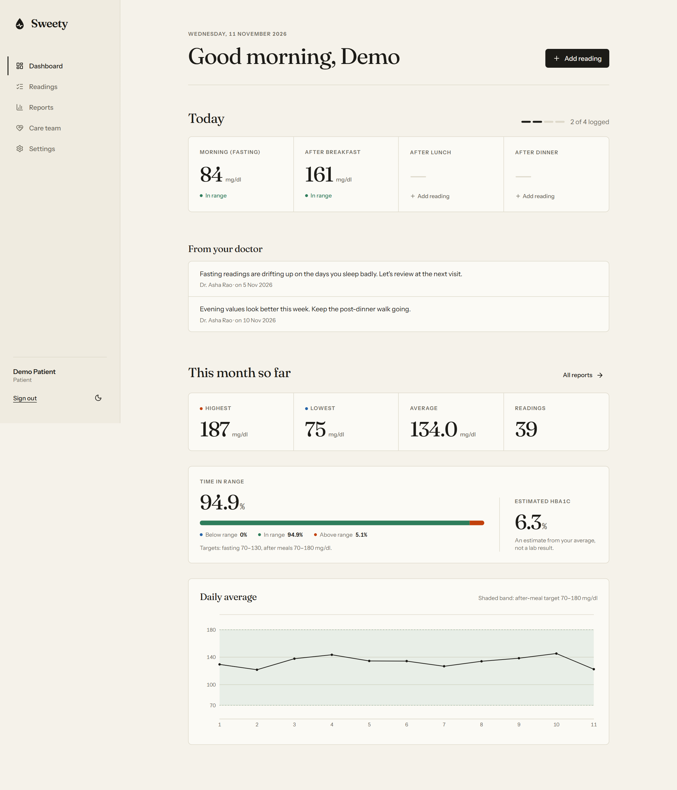
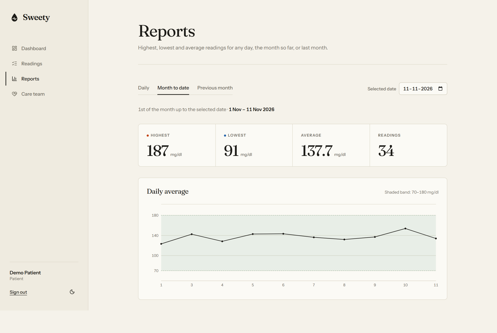

# 🩸 Sweety – Blood Glucose Tracker

Sweety lets a diabetes patient record up to **4 blood-glucose readings a day** (Morning fasting, After breakfast, After lunch, After dinner) and view **daily, month-to-date and monthly reports**.

**Stack:** Node.js + Express API · PostgreSQL · React (Vite) · Tailwind CSS v4 with shadcn-style components · Recharts · Redis + BullMQ (optional)

| Dashboard | Reports |
|---|---|
|  |  |

More screenshots (login, validation errors, duplicate slot, empty state, mobile, dark mode, doctor view) are in [`docs/screenshots`](docs/screenshots).

## Features

**Required**
- Sign up / log in. Passwords hashed with bcrypt (`bcryptjs`, cost 10); JWT auth; users only ever see their own readings.
- Add, view, edit and delete readings (date, slot, value in mg/dl) with all five validation rules and the exact error messages from the brief, shown inline in the UI **and** enforced by the API.
- Reports – highest, lowest, average (1 decimal) and count, with a friendly empty state:
  - **Daily** – the selected date (plus the list of readings with their slots)
  - **Month to date** – 1st of the month → selected date
  - **Monthly** – the whole previous month

**Bonus (all implemented)**
- ✅ Pagination: `GET /api/readings?page=1&limit=20` (+ `date`, `from`, `to` filters)
- ✅ Charts: daily-average line chart with a 70–180 mg/dl reference band (Recharts)
- ✅ Docker: `docker-compose.yml` for PostgreSQL, Redis, API and the client
- ✅ Frontend tests with React Testing Library (reading form)
- ✅ Redis cache for reports, invalidated whenever a reading is created/edited/deleted
- ✅ BullMQ job: a daily reminder log for patients with fewer than 4 readings today
- ✅ Doctor role: patients share their data with a doctor by email; doctors see a patient list and the same reports

Extras: light/dark mode, responsive layout with mobile bottom navigation, toasts, skeleton loaders, rate-limited auth routes.

## Install

Requires **Node.js 20+** and a PostgreSQL 14+ database.

```bash
git clone <this repo> && cd kenpath
npm run install:all          # installs server + client dependencies
cp server/.env.example server/.env
```

## Set up the database

Pick one:

**A. Docker (recommended)**
```bash
docker compose up -d db redis     # PostgreSQL on :5432, Redis on :6379
```
Then set `REDIS_URL=redis://localhost:6379` in `server/.env` to turn on caching + the reminder job (optional).

**B. No Docker** – a real PostgreSQL binary downloaded via `embedded-postgres` (keep it running in its own terminal):
```bash
npm --prefix server run db:embedded
```

**C. Your own PostgreSQL** – create a database and point `DATABASE_URL` in `server/.env` at it.

The schema is applied automatically when the server starts. To apply it by hand: `npm --prefix server run migrate`.

### Seed demo data
```bash
npm run seed
```
Creates (and resets) a demo patient with ~75 days of sample readings, plus a demo doctor the patient has shared with:

| Role | Email | Password |
|---|---|---|
| Patient | `demo@sweety.app` | `Password123!` |
| Doctor | `doctor@sweety.app` | `Password123!` |

## Run

```bash
npm run server     # API on http://localhost:4000
npm run client     # UI  on http://localhost:5173 (proxies /api to the API)
```

Or run everything in containers: `docker compose up --build` → UI at http://localhost:8080.

## Tests

```bash
npm test                         # server + client
npm --prefix server test         # API integration + unit tests
npm --prefix client test         # React Testing Library tests
```

Server integration tests run against a **real PostgreSQL**. By default a throwaway embedded instance is started automatically (no setup). To use your own DB instead set `TEST_DATABASE_URL` (the tests truncate its tables, so use a dedicated database).

What is covered: report date ranges (incl. January→December and leap-year February), stats rounding, every validation rule and its message, the 4-per-day cap (including concurrent requests), edit/delete, user isolation, pagination, all three reports and the empty state, doctor access control, and the reminder query. Frontend: the reading form's validation messages, server-error mapping and successful submit.

## API overview

All routes are under `/api`; send `Authorization: Bearer <token>`.

| Method & path | Purpose |
|---|---|
| `POST /auth/signup` `{name,email,password,role?}` · `POST /auth/login` · `GET /auth/me` | Auth |
| `GET /readings?page&limit&date&from&to` | Your readings, newest first, paginated |
| `POST /readings` · `PUT /readings/:id` · `DELETE /readings/:id` | Create / edit / delete (`{date, slot, value, notes?}`) |
| `GET /reports/daily \| month-to-date \| monthly?date=YYYY-MM-DD` | Report (defaults to today). Doctors add `&patientId=` |
| `GET/POST /me/doctors` · `DELETE /me/doctors/:id` | Patient shares/revokes access for a doctor |
| `GET /doctor/patients` · `GET /doctor/patients/:id/readings` | Doctor views |

Slots: `morning`, `after_breakfast`, `after_lunch`, `after_dinner`. Errors look like `{"error": {"message", "field", "code"}}`.

## Project layout
```
server/  Express API  (routes → services → pg; lib = dates/stats/validation/cache; jobs = BullMQ)
client/  React app    (pages, components, components/ui = shadcn-style primitives, lib, hooks)
docs/    screenshots
```

## Notes

### Assumptions
- **Date & timezone:** "Today" (for the no-future-dates rule and reports default) is computed in `APP_TIMEZONE` (default UTC) on the server. A user far ahead of that zone could be told today's date is "in the future".
- **"Previous month"** for the Monthly report is relative to the *selected* date (15 Oct → September), as in the example.
- **Whole numbers only:** decimals such as `100.5` are rejected with "Value must be a whole number between 40 and 600 mg/dl.", out-of-range values with the exact message from the brief.
- **Rule order:** if a day already has 4 readings the "only 4 readings per day" message wins over the "slot already used" one. Since there are exactly 4 slots, the cap is also guaranteed by a unique `(user, date, slot)` constraint; creation is serialised with a per-user-per-day advisory lock so concurrent requests can't bypass it.
- **Doctor role:** anyone can choose "Doctor" at sign-up (there is no verification). Access is **patient-initiated**: a doctor sees only patients who added the doctor's email under *Care team*, and can revoke it any time. Doctors have read-only access.
- **Reference range** (70–180 mg/dl, used for the Low / In range / High badges and chart band) is a common general guideline shown for convenience only and is not configurable yet.
- **bcrypt:** uses `bcryptjs` (pure JS, same hash format) to avoid native build problems on Windows.
- **Reminders** are only *logged* (no email/SMS is sent). They need Redis; without `REDIS_URL` the job and cache are silently disabled.
- Tokens are stored in `localStorage` for simplicity.

### What I'd improve with more time
- Per-user timezone and configurable target ranges (and different ranges for fasting vs post-meal).
- Refresh tokens / httpOnly cookies, email verification, password reset, verified doctor accounts.
- Real notification delivery for reminders (email/push) and a per-user reminder preference.
- Export reports (PDF/CSV), weekly view, HbA1c estimate, and notes/tags (e.g. meal, exercise).
- Code-splitting the client bundle, E2E tests (Playwright) in CI, and an OpenAPI spec for the API.
- Docker images are provided but I could not run `docker compose` on the machine used to build this (Docker Desktop wasn't running); the API/UI themselves were verified locally against a real PostgreSQL.
